<h1 align="center">📊 Analytics Dashboard Portfolio</h1>

  <b>Operational BI dashboards for customer-service escalations and warehouse cost controlling.</b> 
  Built end-to-end: data model → KPI definition → dashboard design → stakeholder rollout.

  
  
  
  
  

---

  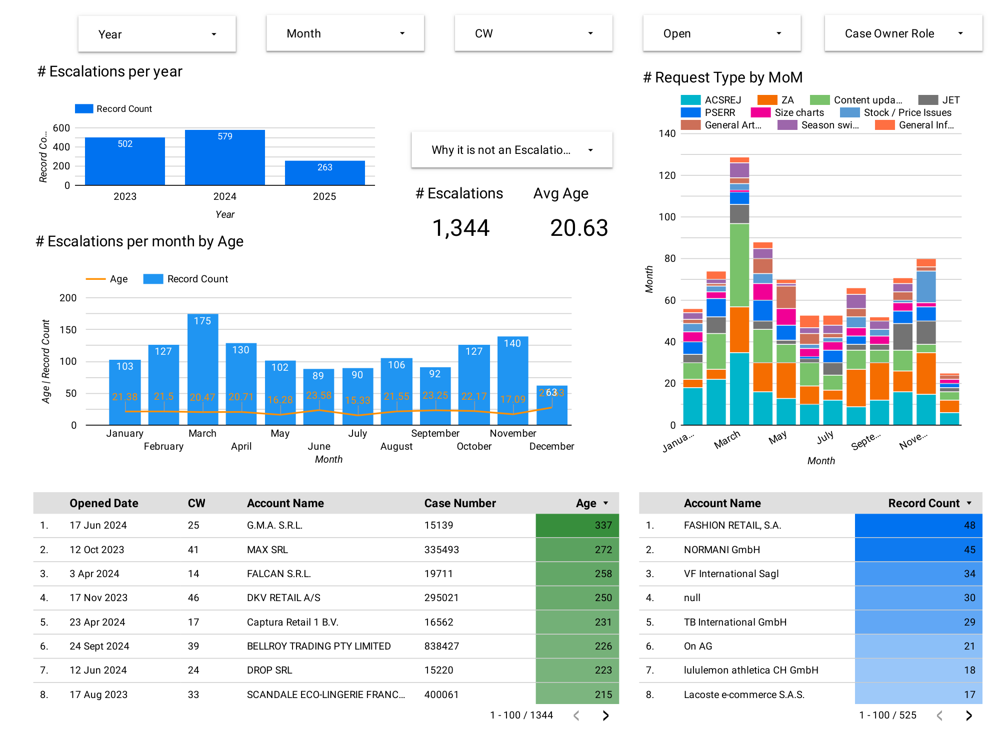 
  <b>Partner Care — Escalation Tracker</b> · 1,344 cases · 525 accounts · 74 agents · 2023–2025

  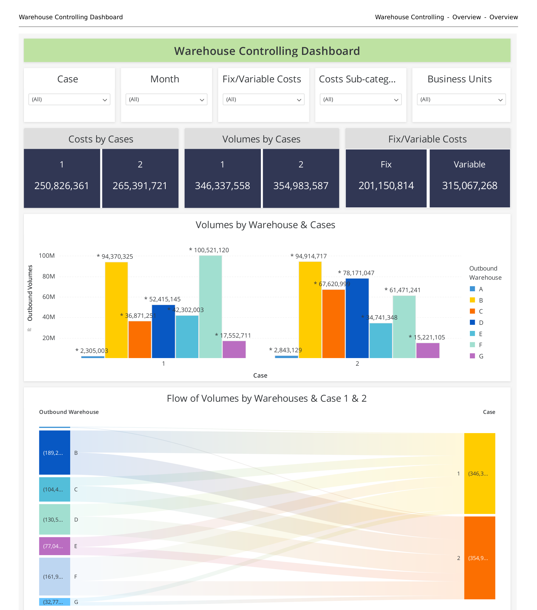
  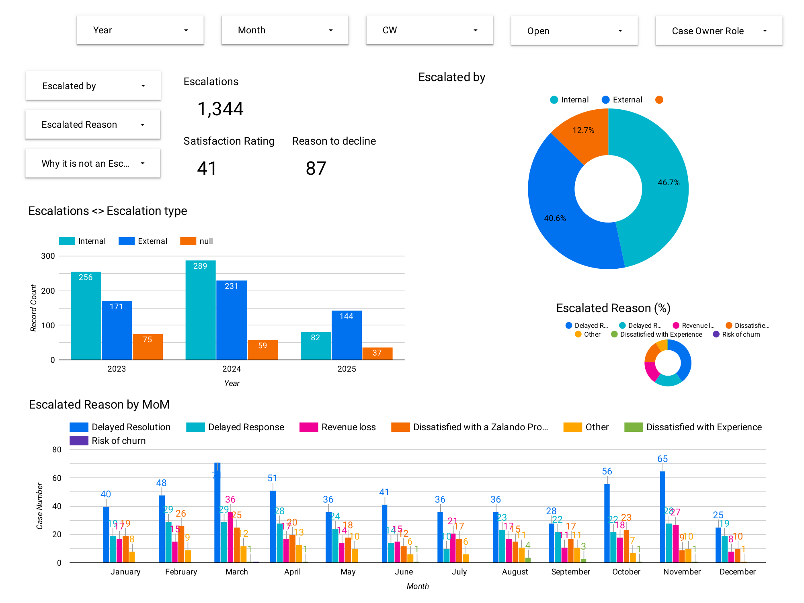

---

## 👋 About

I'm **Rohit Shinde**, a BI / Data Analyst based in Berlin. This repository collects two
production dashboards I designed and shipped — both are used by operations managers and
team leads to steer day-to-day decisions, not one-off analyses.

| | Dashboard 1 | Dashboard 2 |
|---|---|---|
| **Domain** | Partner Care — service escalations | Logistics — warehouse cost controlling |
| **Scale** | 1,344 escalations · 525 accounts · 74 agents | €516M cost · 701M outbound items · 8 sites |
| **Horizon** | 2023 – 2025 | 12 months × 2 planning scenarios |
| **Audience** | Service leads, vendor managers | Finance controllers, site managers |

---

## 1️⃣ Partner Care — Escalation Tracker

Tracks every escalated support case from intake to resolution, so service leads can see
**where cases get stuck, who is raising them, and which accounts are at risk of churn.**

### What it answers

- **Where is the backlog?** Volume and average resolution age, split by month, calendar week and year.
- **Why do partners escalate?** Delayed resolution, delayed response, revenue loss, risk of churn.
- **Is it us or them?** Internal vs. external escalation source, tracked over time.
- **Which work drives it?** Request-type and category Pareto — article onboarding dominates at **851 of 1,344 cases**.
- **How are the vendors performing?** Side-by-side comparison of the two outsourcing partners, down to individual agent workload.
- **What needs executive attention?** A dedicated high-level escalation view for the 18 cases that reached leadership.

### Headline KPIs

<table>
<tr>
<td align="center"><b>1,344</b> escalations tracked</td>
<td align="center"><b>20.6 days</b> avg. resolution age</td>
<td align="center"><b>87</b> resolutions declined</td>
<td align="center"><b>18</b> high-level escalations</td>
</tr>
</table>

### Overview

### Escalation reasons & source

<b>📂 See all 9 dashboard pages</b>

**Satisfaction & declined resolutions** — pairs PSAT scores against rejected resolutions to find where "closed" didn't mean "solved".
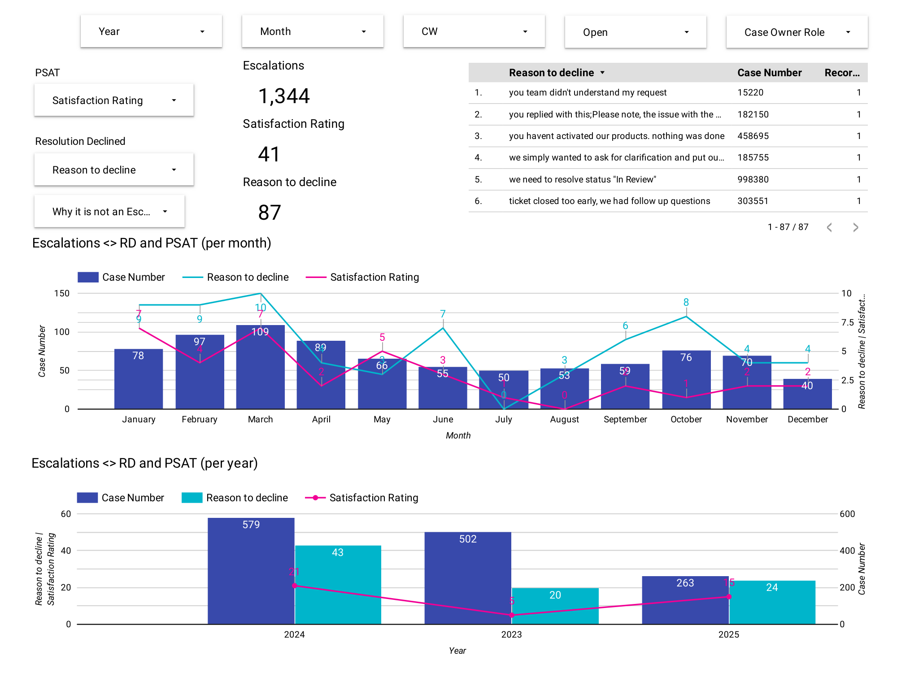

**Categories & request types** — year-over-year mix, plus a category/age Pareto that exposes the slowest work.
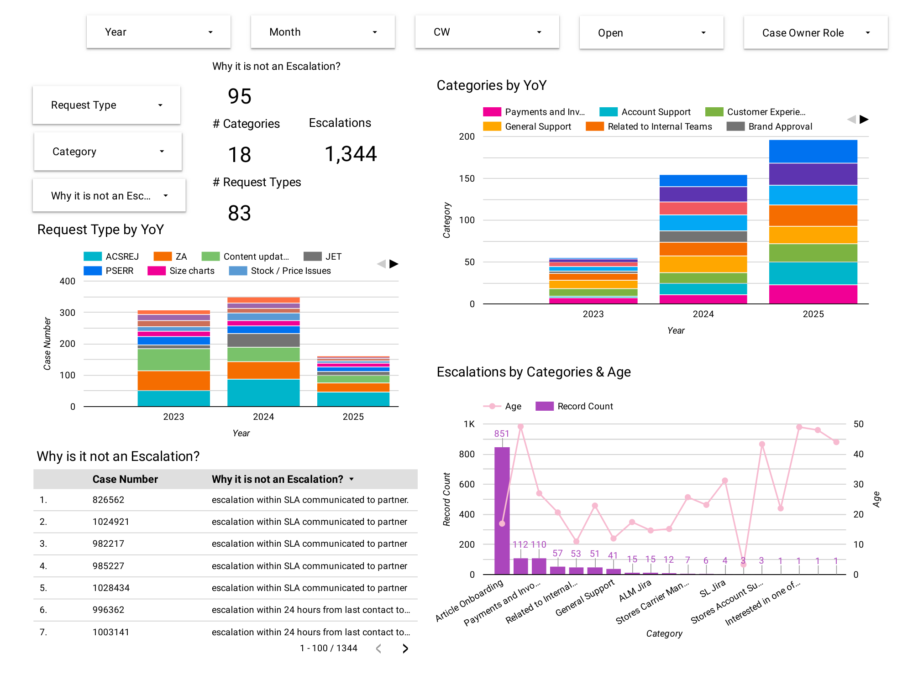

**Vendor performance** — escalation volume and category mix per outsourcing partner.
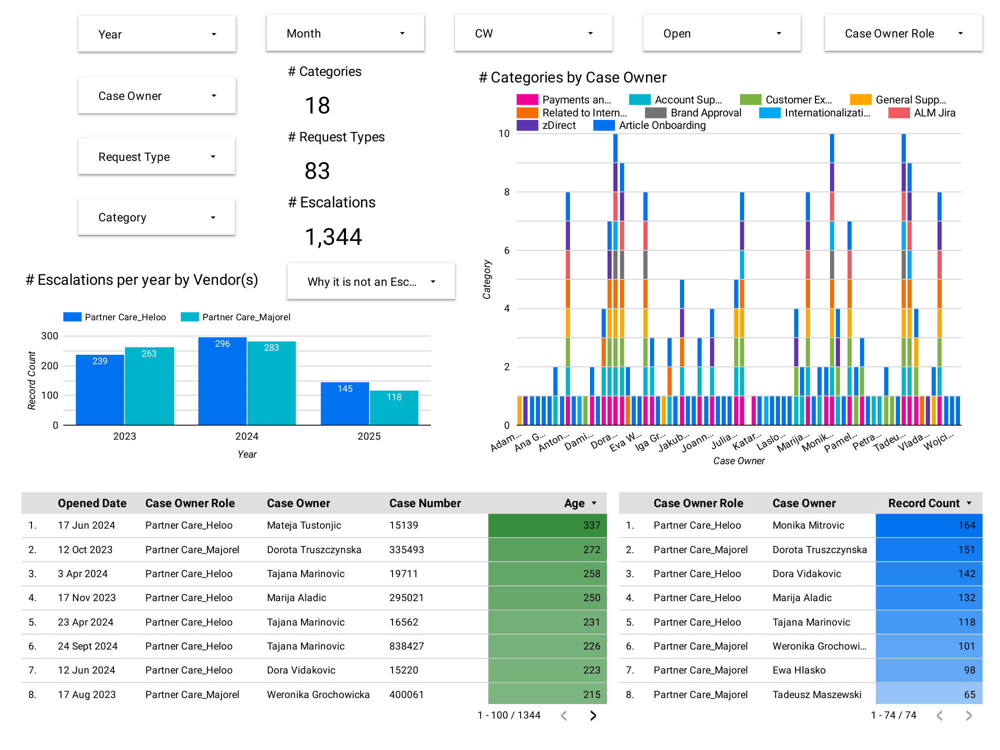

**Agent workload** — request-type distribution per case owner, used for coaching and capacity planning.
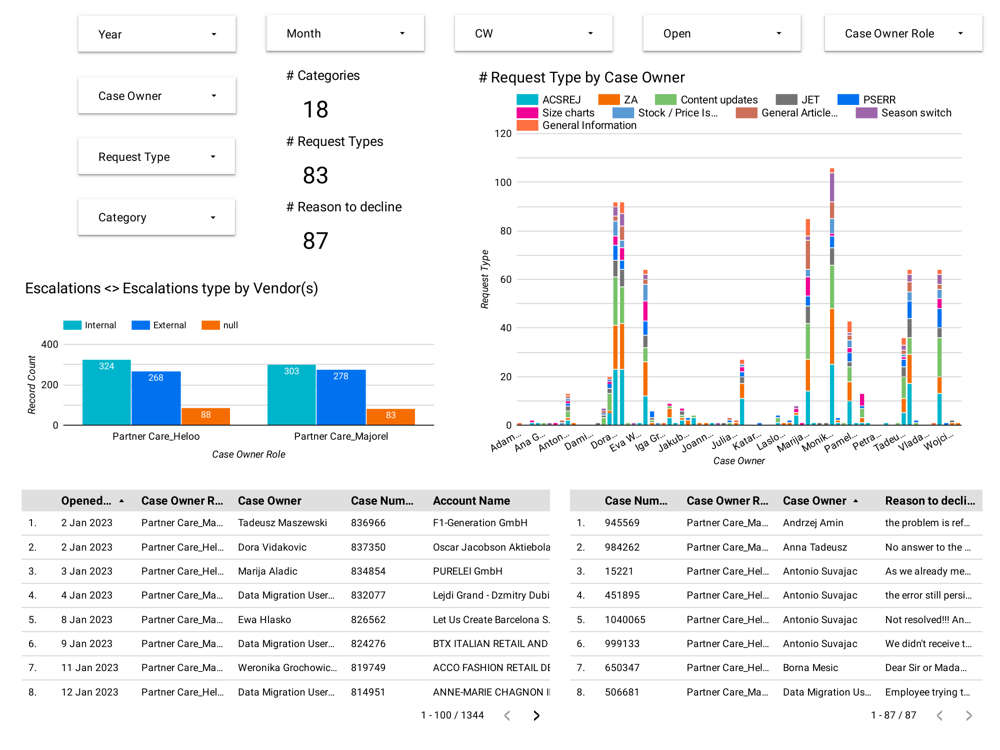

**High-level escalations — overview**
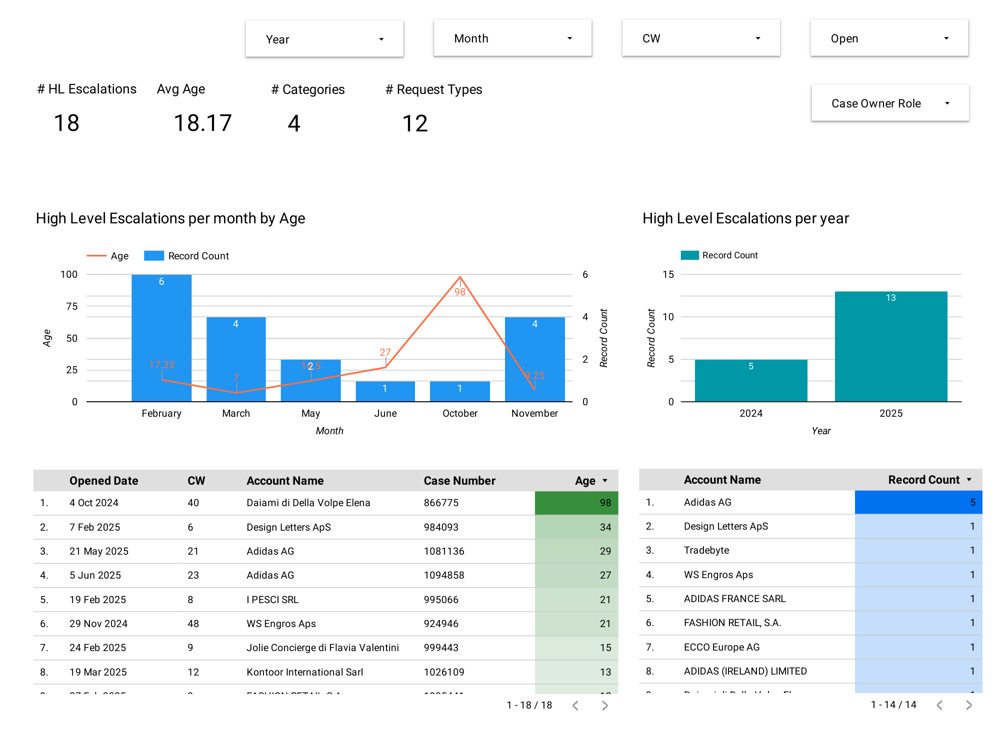

**High-level escalations — category & request-type breakdown**
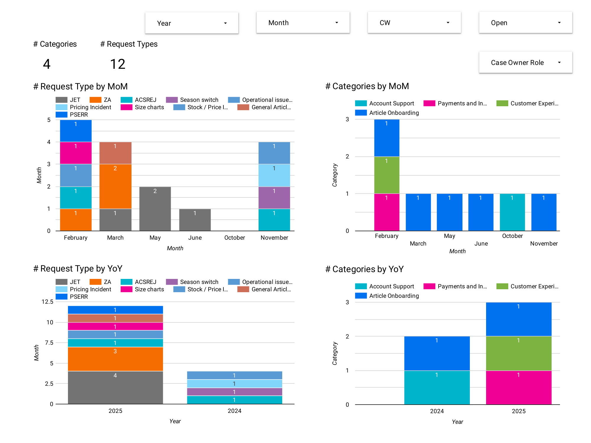

**High-level escalations — by vendor and case owner**
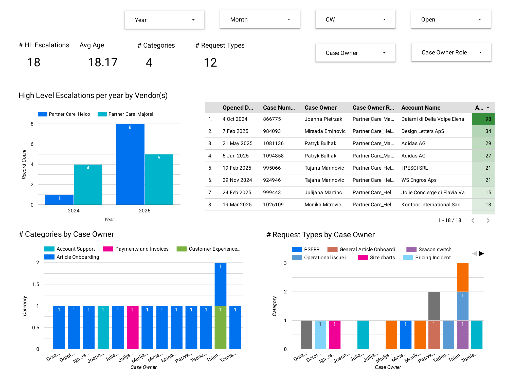

---

## 2️⃣ Warehouse Controlling Dashboard

A finance-facing cost-control dashboard covering **8 outbound warehouses across two
planning scenarios**, built so controllers can compare budget against forecast at site,
month and cost-category level.

### What it answers

- **What does fulfilment actually cost?** €516M total, split **€201M fixed / €315M variable**.
- **Which site is efficient?** Cost per item by warehouse and cost type — the spread runs from **€0.25 to €0.92 per item**, a 3.7× gap between the best and worst site.
- **Where does volume flow?** A Sankey of 701M outbound items across sites and scenarios.
- **What drives fixed cost?** Top-15 sub-category breakdown — salaries & wages (28%), lease depreciation (18%), external freelancers (11%).
- **How do the two scenarios differ?** Every view is scenario-comparable, so a €14.6M planning delta can be traced to the site that caused it.

### Headline KPIs

<table>
<tr>
<td align="center"><b>€516M</b> total cost</td>
<td align="center"><b>701M</b> outbound items</td>
<td align="center"><b>€0.74</b> blended cost / item</td>
<td align="center"><b>39%</b> fixed cost share</td>
</tr>
</table>

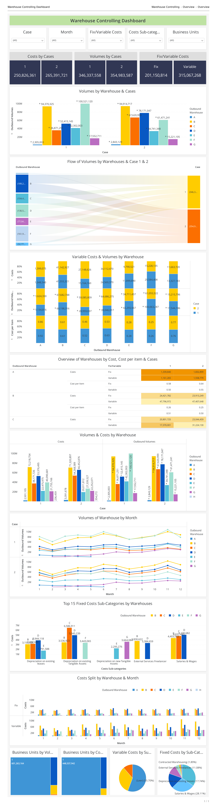

---

## 🛠️ How these were built

| Stage | What I did |
|---|---|
| **Source** | Salesforce case exports, warehouse cost ledgers, volume feeds |
| **Modelling** | SQL views for case ageing, SLA breach flags, cost-per-item and fixed/variable allocation |
| **Metric layer** | Defined and documented every KPI (resolution age, escalation rate, cost per item) so numbers match across teams |
| **Visualisation** | Looker Studio & Tableau — cross-filtering on year, month, calendar week, vendor, case owner and open status |
| **Rollout** | Weekly operating review; dashboards replaced manual spreadsheet reporting |

### Design decisions worth calling out

- **One filter bar, every chart.** All views share the same slicers, so a question asked at the top is answered consistently across the whole page.
- **Pareto-first layout.** Category and request-type views are ordered by volume, so the 80/20 is visible without reading a single number.
- **Age next to volume.** Counting escalations is not enough — pairing volume with average age distinguishes "lots of easy cases" from "a few that are stuck".
- **A separate executive view.** High-level escalations get their own page rather than a filter, because leadership needs a page they can open without configuring anything.

---

## 📫 Contact

- **GitHub:** [@DatawithRS](https://github.com/DatawithRS)
- **Email:** rohitshindeit10@gmail.com

Dashboards are shown as exported screenshots. Underlying data is proprietary and is not included in this repository.
